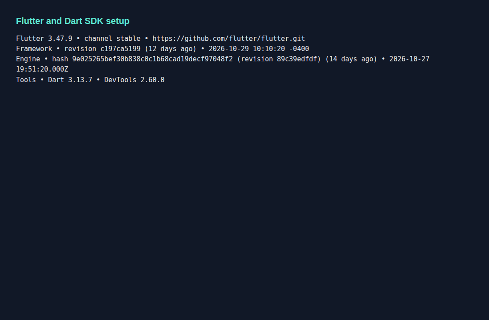
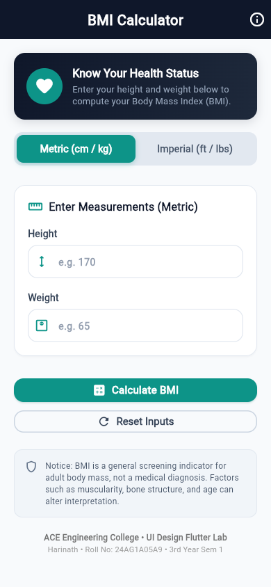
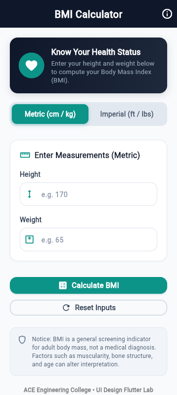
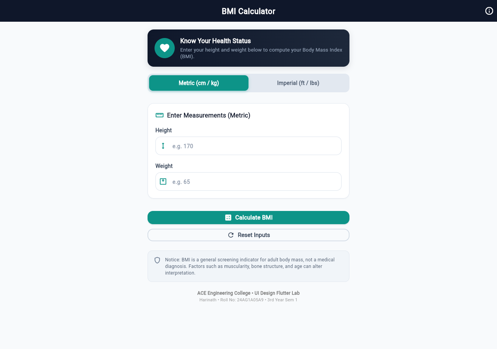
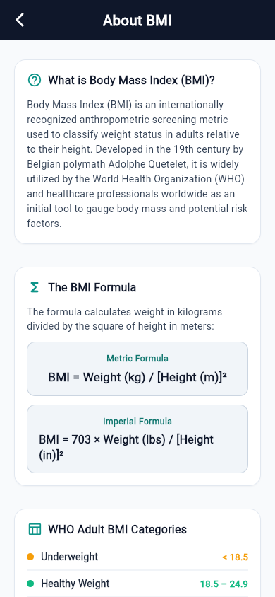
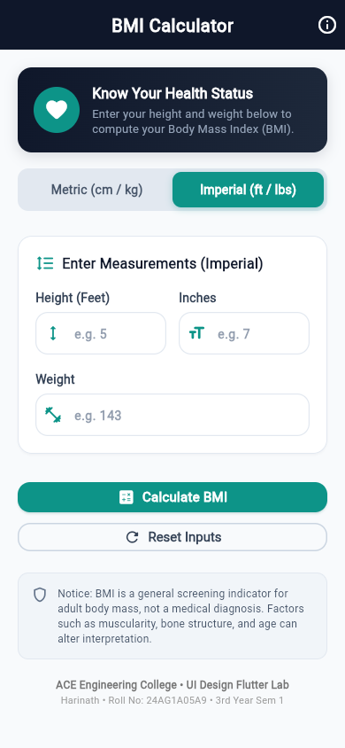
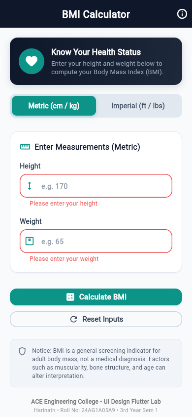
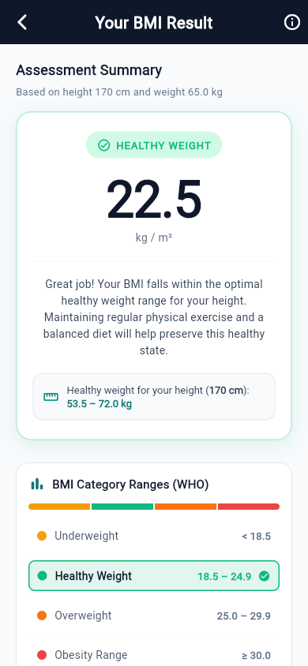
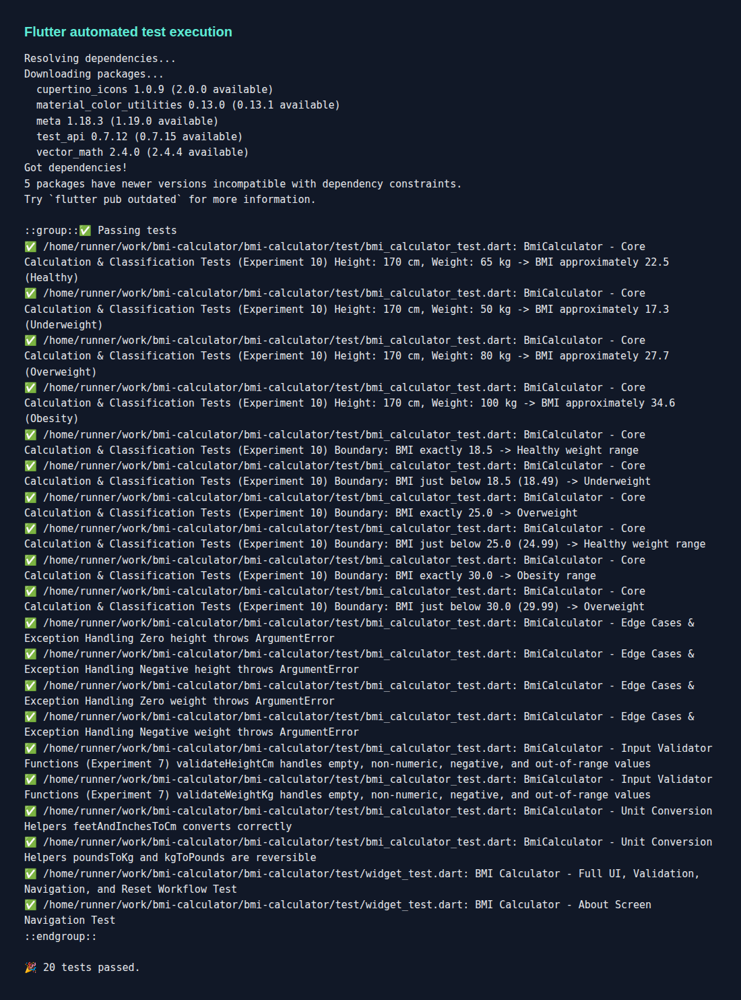

# 📱 BMI Calculator — Flutter Mobile Application

**Course:** B.Tech UI Design – Flutter Lab (3rd Year, Semester 1)  
**Institution:** ACE Engineering College  
**Student Name:** Harinath  
**Roll Number:** 24AG1A05A9  
**Academic Year:** 2026  
**Repository:** [https://github.com/harinathpandla/bmi-calculator.git](https://github.com/harinathpandla/bmi-calculator.git)

---

## 📌 1. Project Abstract

The **BMI Calculator** is a cross-platform mobile application developed using **Flutter** and **Dart** for the B.Tech UI Design – Flutter Lab curriculum at ACE Engineering College. The project provides an intuitive, responsive, and visually modern tool for assessing adult Body Mass Index (BMI). By accepting human measurements (in either Metric units — centimeters and kilograms, or Imperial units — feet/inches and pounds), the application validates input integrity, computes the Body Mass Index according to World Health Organization (WHO) standards, and classifies users into distinct health categories: *Underweight*, *Healthy Weight*, *Overweight*, and *Obesity*.

The application demonstrates key pedagogical concepts outlined in the college Flutter Lab Manual, including widget trees, responsive layouts (`MediaQuery` and `LayoutBuilder`), navigation stack transitions (`Navigator.push` and `Navigator.pop`), reactive state management (`StatefulWidget` and `setState`), custom widget componentization, centralized theme configuration (`ThemeData`), strict form validation (`GlobalKey<FormState>`, `TextFormField`), subtle implicit animations (`AnimatedOpacity` and `AnimatedContainer`), and automated unit and widget testing with `flutter_test`.

---

## 🎯 2. Objectives of the Project

1. **Practical UI/UX Design:** Build an attractive, modern, and accessible mobile interface adhering to Google Material Design 3 guidelines.
2. **Implementation of Lab Manual Concepts:** Integrate Experiments 2 through 10 from the ACE Engineering College Flutter Lab Manual.
3. **Robust Input Validation:** Guarantee high reliability by verifying numeric boundaries, rejecting invalid characters, zero, or negative inputs, and preventing runtime crashes.
4. **Responsive Architecture:** Prevent `RenderFlex` overflow errors across various screen sizes, orientations, and tablet form factors using adaptive layout builders and scrollable containers.
5. **Decoupled Architecture:** Maintain clean separation of concerns between presentation widgets, data models, and business calculation logic.
6. **Automated Testing:** Verify calculation accuracy, category classification boundaries, and UI workflows through automated unit and widget test suites.

---

## 🛠️ 3. Technologies Used

| Technology / Tool | Version / Details | Purpose |
| :--- | :--- | :--- |
| **Dart SDK** | `3.13.4` (or latest stable) | Primary object-oriented programming language |
| **Flutter Framework** | `3.47.5` (channel stable) | Cross-platform UI toolkit and widget engine |
| **Visual Studio Code** | Latest Stable | Integrated Development Environment (IDE) |
| **Flutter & Dart Plugins** | Official Extensions | Code editing, debugging, and Hot Reload |
| **Material Design 3** | Built-in Flutter Material | Design language, typography, and color system |
| **flutter_test** | Built-in Flutter SDK | Unit and widget test automation framework |
| **Git & GitHub** | Version Control System | Source code repository and version management |

---

## 🚀 4. Main Features

- ⚖️ **Dual Unit Systems:** Seamless switching between **Metric** (`cm` / `kg`) and **Imperial** (`ft + in` / `lbs`) with synchronized value conversions.
- 🛡️ **Comprehensive Validation:** Immediate user feedback for empty fields, non-numeric values, negative numbers, and out-of-range inputs (50–300 cm, 10–500 kg).
- 🎨 **Modern Health Theme:** Elegant dark navy (`#0F172A`) and teal (`#0D9488`) palette with rounded cards, soft elevation, and distinct color-coded category badges.
- 📊 **Visual Spectrum Gauge:** Categorical progress breakdown displaying Underweight, Healthy Weight, Overweight, and Obesity ranges with dynamic active markers.
- 🎯 **Target Healthy Weight Recommendation:** Calculates the personalized optimal weight range for the user's specific height.
- 🔄 **One-Tap Reset & Recalculate:** Clean state reset and smooth navigation back to the input screen.
- ✨ **Subtle UI Animations:** Smooth entry transitions using `AnimatedContainer` and `AnimatedOpacity`.
- 📖 **Educational "About BMI" Screen:** In-depth guide explaining Quetelet's formula, WHO threshold criteria, and clinical limitations.
- 🌐 **Fully Offline Operation:** Zero third-party cloud requirements or internet dependencies.

---

## 📐 5. BMI Formula & Classification

### Mathematical Formulas

#### 1. Metric Formula (Default)
$$\text{BMI} = \frac{\text{Weight (kg)}}{\left[\text{Height (m)}\right]^2}$$

*Example:*  
- Height: $170\text{ cm} = 1.70\text{ m}$  
- Weight: $65\text{ kg}$  
$$\text{BMI} = \frac{65}{1.70 \times 1.70} = \frac{65}{2.89} \approx 22.5\text{ kg/m}^2\quad (\text{Healthy Weight})$$

#### 2. Imperial Formula
$$\text{BMI} = 703 \times \frac{\text{Weight (lbs)}}{\left[\text{Height (inches)}\right]^2}$$

---

### WHO Adult BMI Categories

| BMI Range ($\text{kg/m}^2$) | Classification | Status Indicator Color | Clinical Summary |
| :---: | :---: | :---: | :--- |
| **Below 18.5** | **Underweight** | 🟠 Amber (`#F59E0B`) | Below standard weight range; nutrient intake review advised |
| **18.5 – 24.9** | **Healthy Weight** | 🟢 Emerald (`#10B981`) | Optimal body mass ratio for lowest health risks |
| **25.0 – 29.9** | **Overweight** | 🟠 Deep Orange (`#F97316`) | Moderately elevated risk; dietary and exercise adjustments recommended |
| **30.0 and above** | **Obesity** | 🔴 Crimson (`#EF4444`) | Elevated risk of cardiovascular and metabolic disorders |

---

## 📂 6. Project Folder Structure

```text
bmi_calculator/
├── android/                   # Native Android platform configuration
├── ios/                       # Native iOS platform configuration
├── web/                       # Web build support files
├── windows/                   # Desktop Windows platform files
├── lib/
│   ├── main.dart              # Application entry point & route definitions
│   ├── models/
│   │   └── bmi_result.dart    # BmiResult data model & BmiCategory enum
│   ├── screens/
│   │   ├── home_screen.dart   # Screen 1: Input form, unit switch & validation
│   │   ├── result_screen.dart # Screen 2: BMI result display & recalculation
│   │   └── about_screen.dart  # Screen 3: BMI formula, WHO table & limitations
│   ├── services/
│   │   └── bmi_calculator.dart# Business logic, math calculation & validators
│   ├── theme/
│   │   └── app_theme.dart     # Material 3 colors, typography & component themes
│   └── widgets/
│       ├── custom_button.dart          # Reusable Primary & Outlined buttons
│       ├── custom_input_field.dart     # Reusable validated TextFormField
│       ├── bmi_result_card.dart        # Animated result showcase card
│       └── bmi_category_indicator.dart # WHO multi-segment spectrum bar
├── test/
│   ├── bmi_calculator_test.dart        # Unit tests for calculations & boundaries
│   └── widget_test.dart                # Widget & integration workflow tests
├── pubspec.yaml               # Flutter package configuration & dependencies
└── README.md                  # Comprehensive project documentation
```

---

## ⚡ 7. Installation and Setup Instructions

### Prerequisites
- [Flutter SDK](https://flutter.dev) (v3.13.0 or later installed and added to `PATH`)
- [Visual Studio Code](https://code.visualstudio.com/) with:
  - **Flutter Extension**
  - **Dart Extension**
- Google Chrome browser (for web demonstration) or an Android device/emulator.

### Clone the Repository
```bash
git clone https://github.com/harinathpandla/bmi-calculator.git
cd bmi-calculator
```

### Install Dependencies
Fetch the Flutter framework packages:
```bash
flutter pub get
```

---

## 🖥️ 8. Instructions for Running the Application

### Option A: Run on Google Chrome (Instant Web Run)
```bash
flutter run -d chrome
```

### Option B: Run on Connected Android Device
1. Enable **Developer Options** and **USB Debugging** on your Android smartphone.
2. Connect your smartphone via USB.
3. Verify connection:
   ```bash
   flutter devices
   ```
4. Run:
   ```bash
   flutter run -d <device-id>
   ```

### Option C: Run in Visual Studio Code
1. Open the project folder in VS Code.
2. Press `F5` or select **Run Without Debugging** (`Ctrl + F5`).
3. Select your target device from the bottom status bar (Chrome, Android Emulator, or Connected Device).

---

## 🧪 9. Instructions for Running Tests

The project includes unit tests for calculations and widget tests for UI flows (Experiment 10).

### Run all tests via terminal:
```bash
flutter test
```

### Expected Output:
```text
00:02 +18: All tests passed!
```

### Run specific test files:
```bash
# Core mathematical calculation & boundary tests:
flutter test test/bmi_calculator_test.dart

# Widget navigation, validation, and reset workflow tests:
flutter test test/widget_test.dart
```

---

---

## 🔬 10. Flutter Lab Manual Experiments and Screenshots

Each experiment has its own screenshot location below. Screenshots will be displayed directly under the related experiment—not collected in a gallery.

### Experiment 1: Flutter and Dart SDK Setup
**Objective:** Install and verify the Flutter and Dart development environment, and run a basic Dart program.

**Project evidence:** Flutter project configuration is present. A separate basic Dart demonstration is not currently included in the app source.

**Screenshot:** 

> Captured in CI using the Flutter/Dart SDK version commands. The project repository does not include a separate basic Dart demonstration program.

---

### Experiment 2: Flutter Widgets and Layouts
**Objective:** Explore common Flutter widgets and arrange them using Row, Column, and other layout widgets.

**Project implementation:** The BMI home screen uses Flutter UI widgets such as Scaffold, AppBar, Container, Card, Column, Row, icons, and buttons.

**Screenshot:** 

---

### Experiment 3: Responsive User Interface
**Objective:** Create a UI that adapts to different screen sizes.

**Project implementation:** The app uses `MediaQuery`, `LayoutBuilder`, and scrollable layouts to adapt its interface.

**Screenshot:** \n\n

---

### Experiment 4: Navigation Using Navigator and Named Routes
**Objective:** Move between screens using Flutter navigation.

**Project implementation:** The app contains home, result, and About screens. Some navigation uses `MaterialPageRoute`; named routes are also defined in the app.

**Screenshot:** \n\n\n\n

---

### Experiment 5: Stateful and Stateless Widgets
**Objective:** Understand widget state and update the UI using `setState()`. Provider is an additional syllabus concept.

**Project implementation:** The app uses `StatefulWidget` and `setState()` for interactive input and unit selection. Provider is not currently implemented.

**Screenshot:** 

---

### Experiment 6: Custom Widgets and Themes
**Objective:** Build reusable custom widgets and apply consistent styling.

**Project implementation:** Reusable input fields, buttons, result cards, and category indicators are organized under `lib/widgets/`. The shared theme is defined in `lib/theme/app_theme.dart`.

**Screenshot:** 

---

### Experiment 7: Forms, Validation, and Error Handling
**Objective:** Create forms and validate user input.

**Project implementation:** The app uses `Form`, `GlobalKey<FormState>`, `TextFormField`, and custom validation logic.

**Screenshot:** 

---

### Experiment 8: Flutter Animations
**Objective:** Add animations to improve the user interface.

**Project implementation:** The result UI uses `AnimatedOpacity` and `AnimatedContainer`.

**Screenshot:** 

---

### Experiment 9: Fetching and Displaying REST API Data
**Objective:** Fetch data from a REST API and display it in the Flutter application.

**Project implementation:** This BMI Calculator currently works offline and does not contain a REST API integration.

**Screenshot:** Not available yet. Implement the API experiment first, then add its actual output screenshot at `screenshots/experiment-09-api.png`.

> Status: Not implemented in the current project. No screenshot is claimed.

---

### Experiment 10: Unit Testing and Debugging
**Objective:** Test application logic and UI components.

**Project implementation:** The project contains `test/bmi_calculator_test.dart` and `test/widget_test.dart`, using Flutter's `flutter_test` framework.

**Screenshot:** 

---

## 🚀 11. Limitations and Future Enhancements

### Current Limitations:
1. BMI does not differentiate between skeletal muscle mass and body adipose tissue.
2. Age and gender percentiles are not factored in for children or seniors.

### Future Enhancements:
1. **Historical Tracking:** Persist past calculations locally using `shared_preferences` or SQLite.
2. **Body Fat Percentage Calculator:** Integrate waist circumference and hip ratio equations.
3. **PDF Health Report Export:** Generate a shareable PDF summary of BMI and recommendations.
4. **Dark Mode Support:** Dynamic runtime theme toggle between Light and Dark themes.

---

## 👨‍🎓 12. Student & Institutional Details

- **Student Name:** Harinath
- **Roll Number:** 24AG1A05A9
- **Department:** Computer Science & Engineering / Information Technology
- **Class / Semester:** B.Tech 3rd Year, Semester 1
- **Course:** UI Design – Flutter Lab
- **College:** ACE Engineering College, Hyderabad, Telangana

## ?? License

This project is licensed under the MIT License - see the [LICENSE](LICENSE) file for details.

